<p align="center">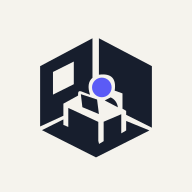</p>
<h1 align="center">Agent Office</h1>
<p align="center"><strong>A live office for your AI agents.</strong></p>
<p align="center">Watch the team work. Talk to your agent. Keep projects moving.</p>
<p align="center">
  <a href="https://www.npmjs.com/package/@alexdeg92/agent-office"></a>
  <a href="LICENSE"></a>
  <a href="#quick-start"></a>
  <a href="#docker"></a>
</p>
<p align="center"><a href="#quick-start">Get started</a> · <a href="docs/guide/user-guide.en.md">User guide</a> · <a href="docs/guide/user-guide.fr.md">Guide français</a> · <a href="https://github.com/alexdeg92/agent-office-oss/releases">Releases</a></p>

<picture>
  <source media="(prefers-color-scheme: dark)" srcset="docs/readme/hero-dark.webp">
  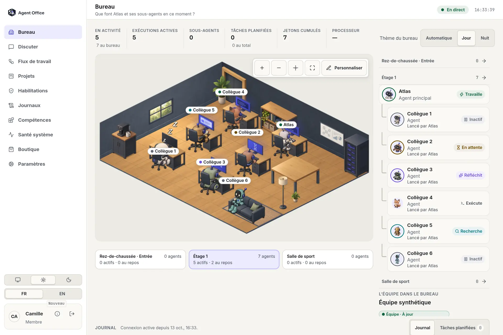
</picture>

## Your team, in one place

Agent Office is a self-hosted dashboard for AI agents, with an animated office that reflects their activity.<br>
Chat, projects, workflows, session logs, skills and system health share one interface, available in French and English.<br>
Connect OpenClaw, Claude Code and Codex side by side, or explore with the included synthetic demo.

<table>
  <tr>
    <td width="33%"><a href="docs/readme/hero-light.webp"></a><br><strong>Bureau · Live office</strong><br>See who is working, thinking or waiting. Subagents are listed under the agent that launched them.</td>
    <td width="33%"><a href="docs/readme/lobby.webp">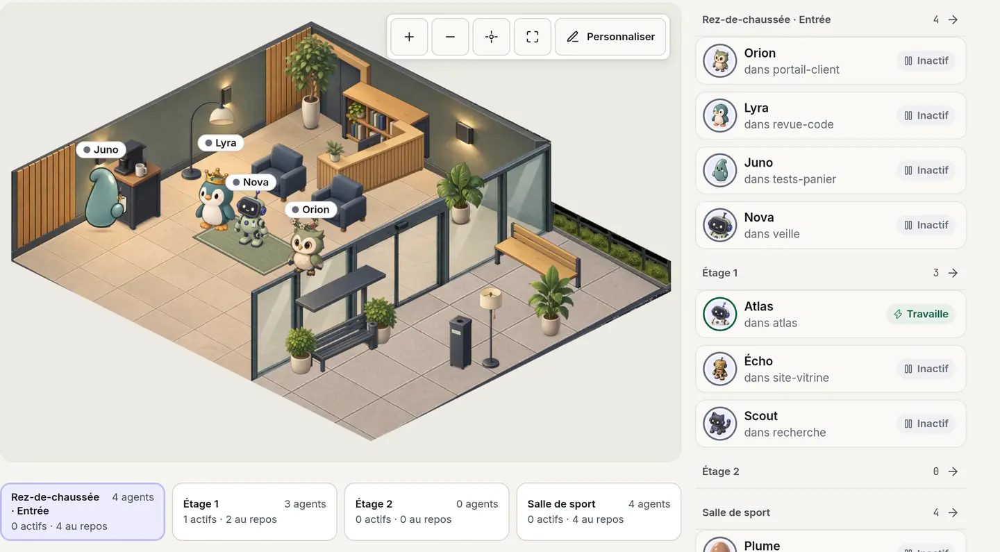</a><br><strong>Floors and teams</strong><br>Idle agents take breaks in the ground-floor lobby, on its terrace or in the <a href="docs/readme/gym.webp">gym</a>. A <a href="docs/readme/teams.webp">team</a> sits together on its own floor, grouped under its lead.</td>
    <td width="33%"><a href="docs/readme/connectors.webp">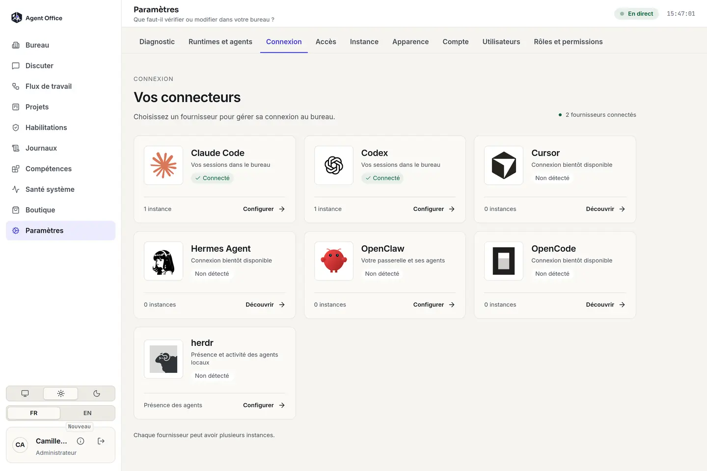</a><br><strong>Connectors · Several runtimes</strong><br>Connect OpenClaw, Claude Code and Codex at the same time, each with its own instances.</td>
  </tr>
  <tr>
    <td><a href="docs/readme/chat.webp">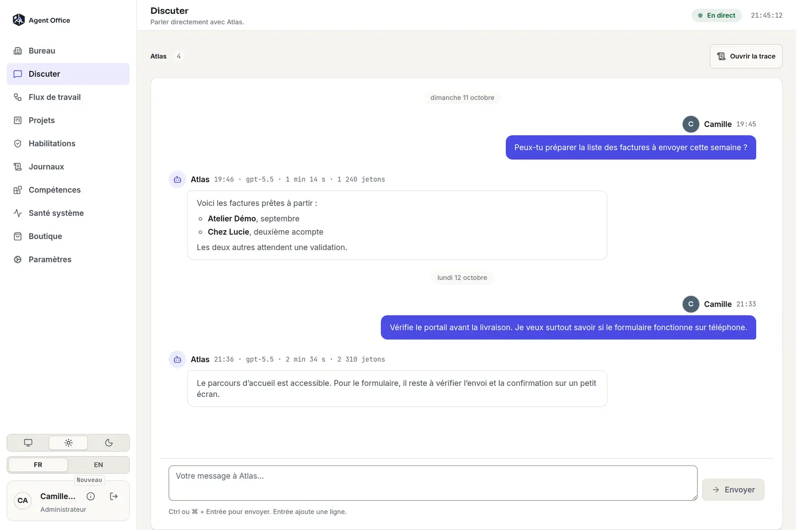</a><br><strong>Discuter · Chat</strong><br>Keep a conversation with your main agent alongside the work.</td>
    <td><a href="docs/readme/projects.webp">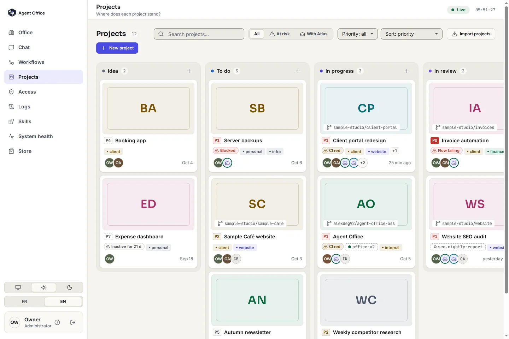</a><br><strong>Projets · Projects</strong><br>Track status, priorities, assignments, risks and comments.</td>
    <td><a href="docs/readme/workflows.webp">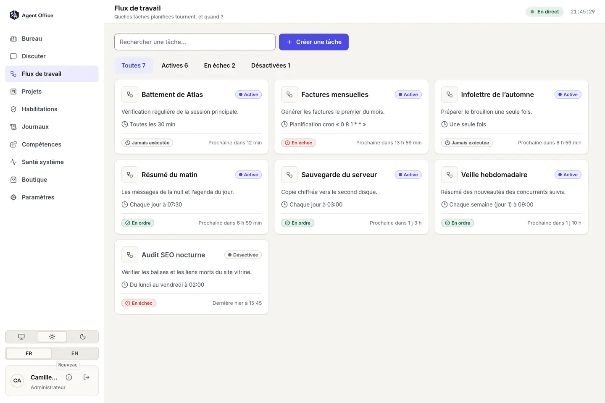</a><br><strong>Flux de travail · Workflows</strong><br>Read scheduled tasks, their last result and next run, and manage them where the runtime allows it.</td>
  </tr>
  <tr>
    <td><a href="docs/readme/logs.webp">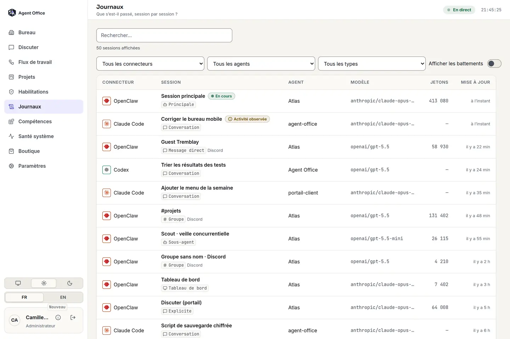</a><br><strong>Journaux · Session logs</strong><br>Read conversations and tool activity from every connected runtime in one list.</td>
    <td><a href="docs/readme/skills.webp">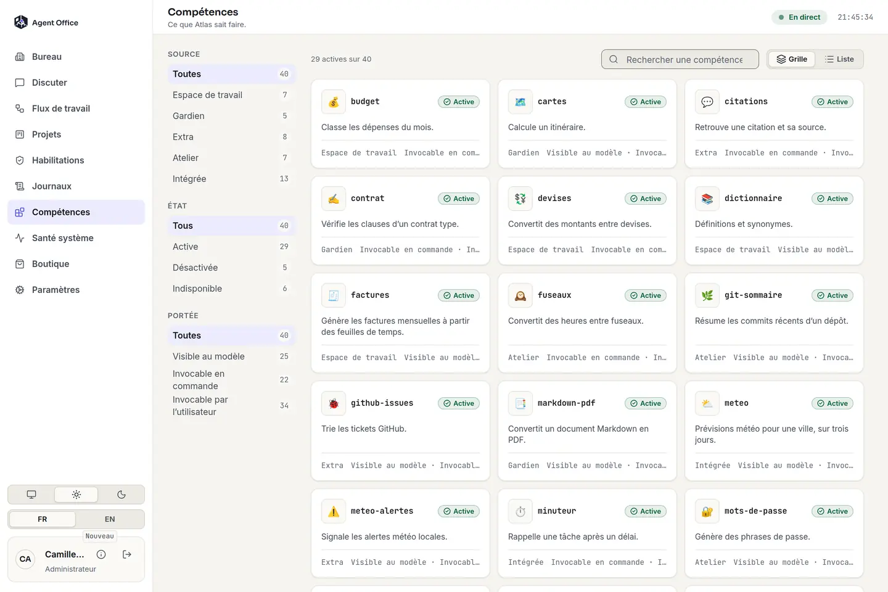</a><br><strong>Compétences · Skills</strong><br>Browse skills, requirements and availability for the connected runtime.</td>
    <td><a href="docs/readme/health.webp">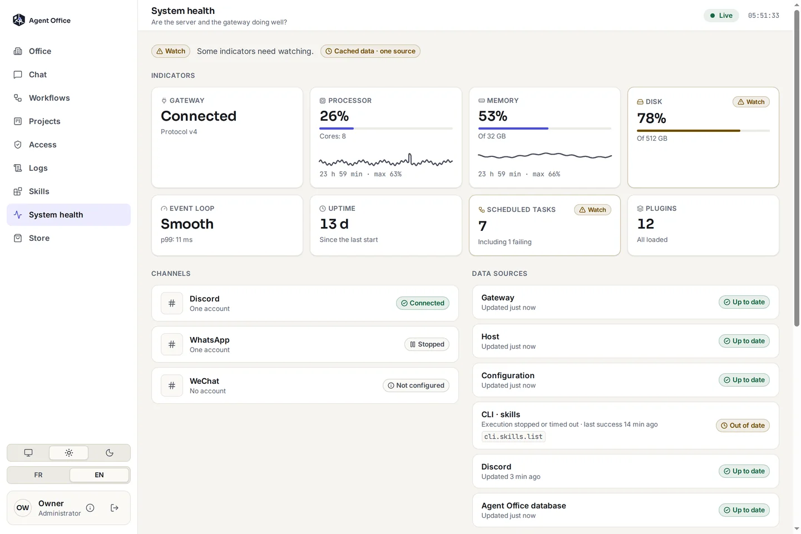</a><br><strong>Santé · Health</strong><br>Check resource use, channels, scheduled tasks and diagnostic issues.</td>
  </tr>
  <tr>
    <td><a href="docs/readme/users.webp">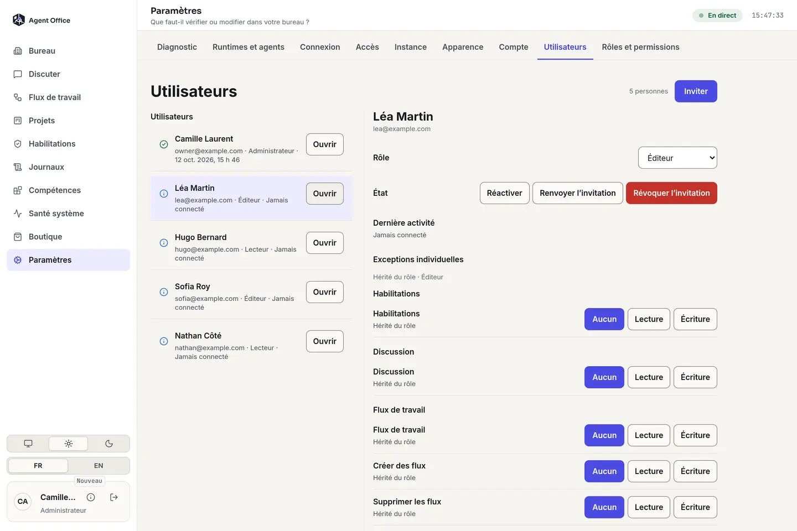</a><br><strong>Users and roles</strong><br>Invite people, give them a role and adjust permissions area by area.</td>
    <td><a href="docs/readme/store.webp">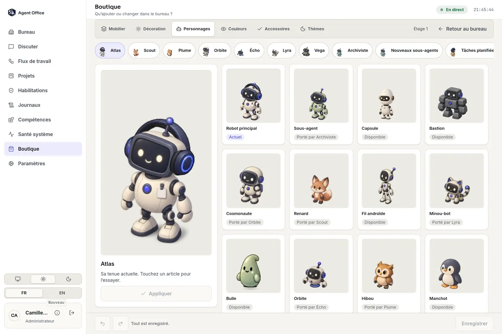</a><br><strong>Boutique · Make it yours</strong><br>Choose characters, colors and accessories. <a href="docs/readme/furniture.webp">Arrange furniture</a> and switch the office mood.</td>
    <td><a href="docs/readme/onboarding.webp">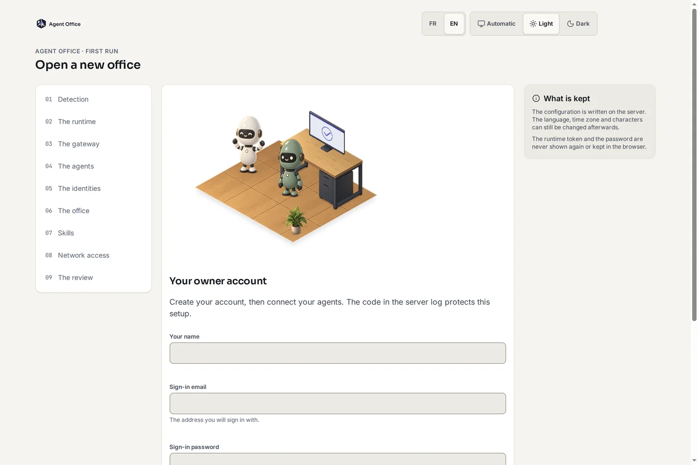</a><br><strong>Guided setup</strong><br>Detect your runtimes, name the agents, pick their look and choose how your team reaches the office.</td>
  </tr>
</table>

*All screenshots show synthetic data in the default French interface. Click an image to view it at full size.*

<details>
<summary>See the office on a phone</summary>
<p align="center">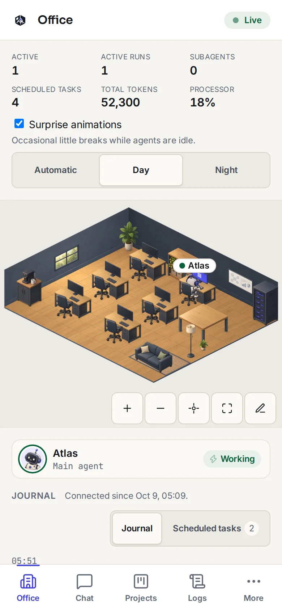</p>
</details>

## What’s new in 1.2.0

- **Several runtimes at once.** Claude Code and Codex adapters join OpenClaw. Their sessions and transcripts appear in the office and the logs, next to each other; Claude Code subagents are shown under the session that started them.
- **Floors and teams.** The Bureau has a furnished ground-floor lobby (reception, lounge, glass facade and an outdoor smoking terrace), office floors and a gym, where idle agents go on break. Teams read from an agent-team-pm store (`AO_TEAM_STORE_ROOT`), optionally joined with Herdr presence, are grouped under their lead and seated together.
- **Multi-user access.** Optional roles (administrator, editor, reader, or your own), invitations and per-user permission exceptions.
- **External access.** A guided plan for local, LAN, private-network, public-domain, split-origin and tunnel access, with server-side checks. It never edits DNS or proxy files.
- **Settings.** Provider cards for connectors, per-runtime agent management, a diagnostic tab, and a reworked phone layout.

## Meet the characters

<p align="center">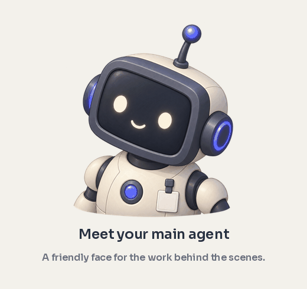</p>

The main robot gives your primary agent a familiar face. Name it yourself—our example office calls it **Atlas**. Give the rest of your team their own look, from a fox or owl to an astronaut, a rolling bot or a tiny blob.

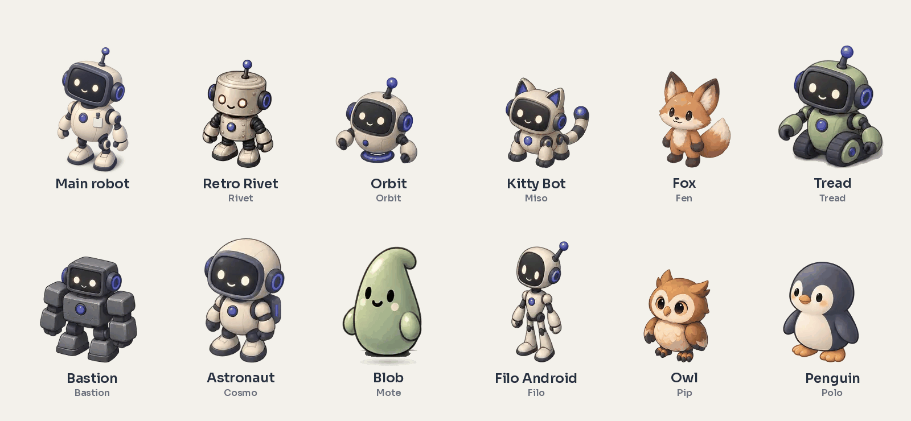

Choose colors and accessories in the Boutique. Character appearance is independent of the runtime, model and agent name.

## A little life between tasks

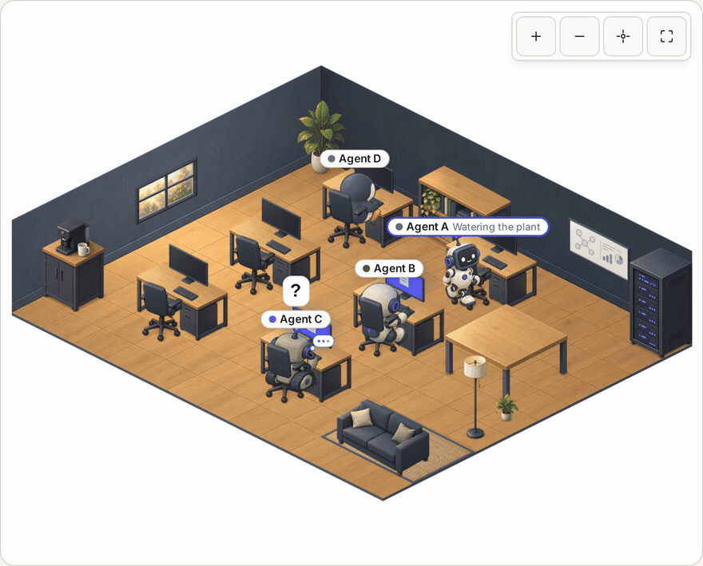

Working agents type at their desks; idle agents can stretch, read, water plants or take a surprise break. The [animation sandbox](docs/readme/sandbox.webp) lets you try those moments directly. The clip above was captured from that sandbox using synthetic agents.

## Quick start

Requires **Node.js 24+**, or Docker. Install Agent Office, open the setup wizard, then start your office:

```sh
npm install -g @alexdeg92/agent-office
agent-office setup
agent-office start
```

Open the URL printed in your terminal, normally **http://127.0.0.1:18789/**. Enter the one-time setup code, create your owner login, and connect your runtime—or choose Demo to explore without one. Add more runtimes later from **Settings → Connexion**. Configuration persists across restarts.

<details>
<summary><strong>Homebrew · macOS</strong></summary>

```sh
brew install alexdeg92/tap/agent-office
agent-office setup --data "$(brew --prefix)/var/lib/agent-office"
brew services start agent-office
```

Complete setup before starting the service. Use Homebrew’s data directory during setup so the service finds the same configuration.
</details>

<a id="docker"></a>
<details>
<summary><strong>Docker</strong></summary>

```sh
docker pull ghcr.io/alexdeg92/agent-office-oss:1.2.0
docker run --rm -it --name agent-office \
  -p 127.0.0.1:18789:18789 \
  -v agent-office-data:/data -v agent-office-config:/config \
  -e PORTAL_COOKIE_SECURE=0 \
  ghcr.io/alexdeg92/agent-office-oss:1.2.0
```

The terminal prints the setup code on first boot. Named volumes retain your configuration and data. This command serves HTTP on your own machine; use secure cookies and `AO_PUBLIC_URL` for an HTTPS reverse proxy.

The image does not bundle OpenClaw. For a live connection, mount the required identity/config files read-only and supply the OpenClaw CLI where needed. [Docker and gateway configuration →](docs/guide/install.md)
</details>

<details>
<summary>Existing configuration, environment files and project integration</summary>

The wizard stores instance configuration separately from secrets, with restricted permissions. Environment variables override file configuration. For environment-managed installs, start with [.env.example](.env.example) and pass your private file:

```sh
agent-office start --env-file /path/to/agent-office.env
agent-office check-config
agent-office doctor
```

Reuse your `--config` and `--data` paths on later runs if you supplied them during setup. Existing configuration or login environment variables lock first-run setup.

The wizard can install the project-tag integration. You can also inspect and install it explicitly:

```sh
agent-office integrations status
agent-office integrations install --dry-run
agent-office integrations install
```

The integration adds a project skill and an `AGENTS.md` block to the selected workspace, with a backup before changes. [Configuration reference](docs/guide/config.md) · [Project integration](docs/guide/project-tag.md)
</details>

## Works with

Agent Office separates its dashboard from the agent runtime through adapters. One instance can connect several runtimes at once.

| Runtime | Current support |
| --- | --- |
| **OpenClaw** | Live activity, chat, workflows, skills, channels and access policies. |
| **Claude Code** | Read-only: sessions, subagents and transcripts from the local Claude Code home. |
| **Codex** | Read-only: sessions, transcripts and token usage from the local Codex home. |
| **Demo** | Included synthetic team; no gateway or runtime installation required. Runtime writes are disabled. |
| **Herdr** (optional source) | Read-only presence of the agents running in its panes, linked to runtime sessions only on an exact identity match. |
| Hermes, OpenCode, Cursor | Shown in the connector gallery; connection is **not available yet**. |

Available actions follow each adapter’s capabilities. [Adapter guide and extension contract →](docs/guide/adapters.md)

## How it fits together

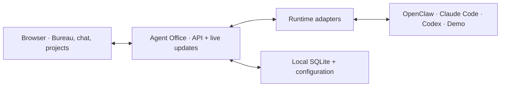

One process serves the UI at `/` and the API at `/backend` by default. UI and API can also be deployed separately behind a reverse proxy. [Architecture](docs/architecture/README.md) · [Deployment guide](docs/guide/deploy.md)

## Security & privacy

Agent Office runs on your own infrastructure. The first-run wizard requires a one-time terminal code and creates an owner login. Secrets stay in private configuration files and the local database; they are excluded from release exports.

Agent Office includes no analytics or telemetry collector. A live runtime, optional project sources and enabled features can make their own network requests. Use HTTPS and secure cookies when exposing the dashboard beyond your machine. [Security policy](SECURITY.md) · [Configuration](docs/guide/config.md)

## FAQ

**Can I try it without OpenClaw?** Yes. Choose Demo in setup for a synthetic office; no gateway token or runtime binary is needed.

**Does it run my agents?** Your runtime runs the agents. Agent Office shows their activity and exposes the actions that runtime supports.

**Can I use another agent runtime today?** OpenClaw, Claude Code, Codex and Demo are the registered adapters, and you can connect several at once. Other runtimes are listed but not connectable yet; see the table above.

**Can several people use it?** Yes. Enable multi-user access with `auth: {"rbacEnabled": true}` in `config.json` (or `AO_RBAC_ENABLED=1`), then invite people from Settings. [Configuration](docs/guide/config.md)

**Can I use it on a phone or in French?** Yes. The interface adapts to smaller screens and includes an English/French switch. [Guide français](docs/guide/user-guide.fr.md)

**Where do I start when something is wrong?** Run `agent-office doctor`, then check the Health view and the [troubleshooting guide](docs/guide/troubleshooting.md).

## Contributing

Bug reports, documentation improvements and adapter contributions are welcome. Read [CONTRIBUTING.md](CONTRIBUTING.md) for development setup, targeted tests and the synthetic-fixture rules. [Changelog](CHANGELOG.md) · [Report an issue](https://github.com/alexdeg92/agent-office-oss/issues)

<details>
<summary>Run from a checkout</summary>

```sh
npm ci
node scripts/build-frontend.js
node packaging/bin/agent-office.js setup
node packaging/bin/agent-office.js start
```

Build before testing or packing. Public exports exclude Git history, secrets and local captures; release preparation is documented in [packaging](packaging/homebrew/README.md).
</details>

## License

[MIT](LICENSE). Bundled fonts retain their accompanying Open Font License notices.
